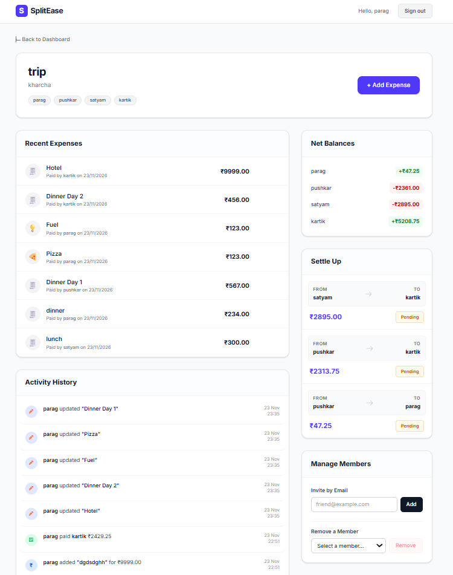

# SplitEase: Group Expense Manager

A full-stack web application to track shared expenses, split bills fairly, and settle up with the fewest possible payments.

Built with FastAPI, PostgreSQL, React, and Docker.

## Features

- Authentication: JWT-based login and registration with bcrypt password hashing.
- Groups: Create groups, invite members by email, and manage participants.
- Smart Expenses: Add expenses with Equal, Exact, Percentage, or Shares splits.
- Integer Money: All amounts are stored as integers (paise/cents) to prevent floating-point drift.
- Debt Simplification: A greedy heap-based algorithm computes the minimum number of payments needed to settle all debts (at most n-1 payments).
- Real-time Balances: See exactly who owes whom, calculated instantly.
- Activity History: A full audit log of who added expenses, settled up, and managed the group.

## Screenshots

### Dashboard

### Group Detail (Balances & Activity)

### Login

## Tech Stack

| Layer | Technology |
|---|---|
| Backend | Python 3.11, FastAPI, SQLAlchemy 2.0, Pydantic v2 |
| Database | PostgreSQL 16, Alembic (migrations) |
| Frontend | React 18, Vite, Tailwind CSS |
| Auth | JWT (python-jose), bcrypt (passlib) |
| Infra | Docker, Docker Compose |
| Testing | pytest, Hypothesis (property-based testing) |

## Architecture

The backend follows a layered architecture:

- Routers: Handle HTTP requests and responses.
- Services: Contain pure business logic (e.g., splits.py, simplify.py, balances.py).
- Models: SQLAlchemy database definitions.
- Schemas: Pydantic models for request validation and response serialization.

The debt simplification and splitting logic are pure functions with no database or HTTP dependency, making them trivially unit-testable.

## Getting Started

### Prerequisites
- Docker Desktop installed and running.
- Node.js 18+ (for the frontend).

### 1. Clone the repo
git clone https://github.com/CodeCrusher24/splitease.git
cd splitease

### 2. Start the Backend (Docker)
docker compose up --build -d

This starts:
- PostgreSQL on port 5432
- FastAPI on port 8000 (with automatic Alembic migrations)

### 3. Start the Frontend
cd frontend
npm install
npm run dev

- Frontend: http://localhost:5173
- API Docs (Swagger): http://127.0.0.1:8000/docs

## Testing

The core algorithms are covered by unit and property-based tests.

cd backend
pytest app/tests/ -v

Property-based tests (using Hypothesis) verify that:
- Splits always sum to the exact total.
- Net balances always sum to zero.
- The settlement plan zeroes out every balance.

## Key Algorithms

### Debt Simplification
Uses a greedy heap-based approach:
1. Split users into creditors (positive net) and debtors (negative net).
2. Match the largest debtor with the largest creditor.
3. Transfer min(debt, credit).
4. Repeat until all balances are zero.

This guarantees at most n-1 payments for n users with non-zero balances. (Finding the true minimum is NP-hard, so greedy is the industry-standard practical approach.)

### Integer Money
All amounts are stored as integers in the smallest currency unit. For example, 100.50 INR is stored as 10050. This avoids the classic floating-point bug.

## License

MIT