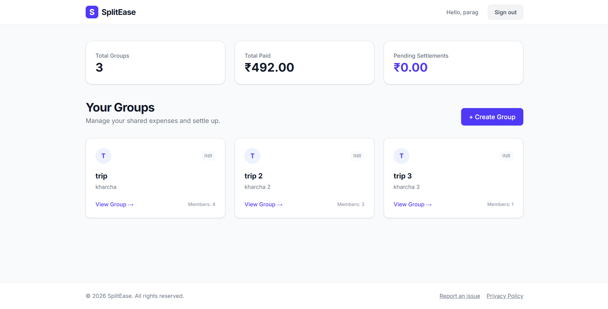
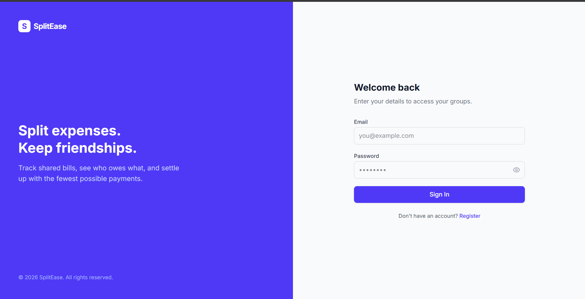

<div align="center">

# SplitEase

**Split group expenses fairly and settle up with the fewest payments.**

A full-stack expense manager for friends, roommates and travel groups. Add shared expenses, split them four different ways, see live balances, track every change in an activity history, and get a simplified settlement plan.


[Getting Started](#getting-started) · [Settlement Algorithm](#the-settlement-algorithm) · [Report a Bug](../../issues)

</div>

---

## Screenshots

| Dashboard | Group Detail |
| :---: | :---: |
|  |  |
| Your groups, stats and what you owe or are owed | Expenses, live balances, activity history and the settlement plan |

<details>
<summary>Login screen</summary>



</details>

---

## Table of Contents

- [Overview](#overview)
- [Features](#features)
- [Tech Stack](#tech-stack)
- [Architecture](#architecture)
- [Engineering Decisions](#engineering-decisions)
- [The Settlement Algorithm](#the-settlement-algorithm)
- [Getting Started](#getting-started)
- [Configuration](#configuration)
- [API Reference](#api-reference)
- [Testing](#testing)
- [Deployment Guide](#deployment-guide)
- [Known Limitations](#known-limitations)
- [Roadmap](#roadmap)
- [Contact](#contact)
- [License](#license)

---

## Overview

Splitting a trip or a flat's bills usually ends with a tangle of small debts: A owes B, B owes C, C owes A. SplitEase tracks every expense in a group, works out each person's net position, and then reduces the web of debts to a short list of payments.

**Example:** four friends and 30 expenses can produce up to 12 pairwise debts. SplitEase settles them with at most **3 payments** (n - 1 for n people).

What makes it more than a CRUD app:

- **Money is never a float.** All amounts are stored as integers in the smallest unit (paise/cents), and uneven splits are distributed deterministically so totals always match to the last paisa.
- **Balances are derived, not stored**, so they cannot drift out of sync after edits or deletes.
- **Every change is logged.** Expenses, settlements and membership changes all appear in a per-group activity history.
- **Core logic is pure and property-tested** with Hypothesis, which checks invariants across thousands of random inputs.

---

## Features

### Accounts
- **Authentication:** register and log in with JWT tokens; passwords hashed with bcrypt.
- **Profile endpoint:** the frontend fetches the current user from `/auth/me` to keep sessions alive across refreshes.
- **Password visibility toggle:** show/hide eye icon on the Login and Register pages.

### Dashboard
- **Stats bar:** Total Groups, Total Paid and Pending Settlements, calculated from real data via the API.
- **Group cards:** each card shows the group name and its member count.

### Groups and members
- **Groups:** create groups and manage who is in them.
- **Leave group:** non-creators can leave a group through a confirmation modal. The API only allows it when the member's balance is zero, so nobody can walk away from a debt.
- **Creator protection:** the Leave Group button is hidden for the group's creator.

### Expenses
- **Full lifecycle:** add, edit and delete expenses with description, amount, category, date and payer.
- **Four split types:** equal, exact amounts, percentages, and shares. Editing an expense recalculates its splits automatically.
- **Categories:** food, travel, utilities, entertainment and general, each shown with an emoji icon on the expense row.
- **Dates:** every expense row displays its date.
- **Hover actions:** pencil (edit) and trash (delete) icons appear when you hover an expense.
- **Custom confirmation modals:** deleting an expense or leaving a group uses an in-app modal instead of the browser's `confirm` dialog.
- **Soft deletes:** deleted expenses are flagged, not erased, keeping history auditable.

### Balances and settlements
- **Live balances:** per-member net balance shown as a colored pill, green when the member is owed and red when they owe.
- **Debt simplification:** a minimal settlement plan with at most n - 1 payments.
- **Settlement flow:** each payment is shown as `From → To` with a Pending badge and a **Mark as Settled** button.
- **Safeguards:** self-payments are rejected, and a timezone-safe duplicate guard with a 5-second window prevents double-clicks from recording the same settlement twice.

### Activity history
- Colored circular icons for each action type: expense created, expense edited, expense deleted, settlement, group created, member added and member removed.
- Members who have left are marked with a "(left)" suffix so history stays readable.

### Polish and platform
- **Shared layout:** a unified Navbar (with a Sign Out button that turns red on hover) and a unified Footer with a contact link and a Privacy Policy link.
- **Pages:** custom 404 page with a back-to-dashboard button, and a Privacy Policy page.
- **SEO and sharing:** page title, description, Open Graph and Twitter card meta tags, a custom purple "S" favicon and a `robots.txt`.
- **Interactive API docs:** Swagger UI generated automatically by FastAPI.
- **One-command backend:** Docker Compose starts the API and PostgreSQL and applies migrations.

---

## Tech Stack

| Layer | Technology |
| :--- | :--- |
| **Backend** | Python 3.11, FastAPI, SQLAlchemy 2.0, Pydantic |
| **Database** | PostgreSQL 16, Alembic migrations |
| **Auth & security** | JWT (python-jose), bcrypt (passlib) |
| **Frontend** | React 18, Vite, Tailwind CSS 4, Axios |
| **Testing** | pytest, Hypothesis (property-based testing) |
| **Infrastructure** | Docker, Docker Compose |

---

## Architecture

```
┌──────────────────┐   HTTPS + JSON    ┌───────────────────────────────┐
│    React SPA     │ ────────────────► │        FastAPI backend        │
│ (Vite, Tailwind) │   Bearer JWT      │                               │
└──────────────────┘                   │  Routers   → HTTP, auth       │
                                       │  Schemas   → Pydantic checks  │
                                       │  Services  → splits, balances,│
                                       │              simplification   │
                                       │  Models    → SQLAlchemy       │
                                       └───────────────┬───────────────┘
                                                       │
                                                       ▼
                                       ┌───────────────────────────────┐
                                       │   PostgreSQL (Alembic)        │
                                       └───────────────────────────────┘
```

The backend is layered so that the interesting logic has no dependency on the web framework or the database:

| Layer | Responsibility |
| :--- | :--- |
| **Routers** | Parse requests, enforce authentication and group membership, return responses |
| **Schemas** | Validate input and shape output with Pydantic |
| **Services** | Pure functions for splitting, balance calculation and debt simplification |
| **Models** | SQLAlchemy tables and queries |

Routers are split by resource (auth, users, groups, and a dedicated expenses router mounted at `/expenses`) so that edit and delete routes for a single expense never collide with group-scoped routes.

Because the services are pure functions, they are fast to unit test and easy to reason about.

---

## Engineering Decisions

### 1. Integer arithmetic for money
Floating point cannot represent most decimals exactly (`0.1 + 0.2 = 0.30000000000000004`). SplitEase stores every amount as an integer in the smallest currency unit, so `100.50` INR is stored as `10050`.

When an amount does not divide evenly, the leftover units are handed out one at a time using the **largest remainder method**. For example, 100.00 split three ways becomes 33.34 + 33.33 + 33.33, and the shares always sum to exactly the total.

### 2. Derived balances
Stored balances drift when expenses are edited or deleted. SplitEase computes net balances on demand with an aggregate query over expenses and settlements:

```
net = paid − owed + settlements paid − settlements received
```

A settlement moves the payer toward zero: when you pay someone back, your debt shrinks and their credit shrinks by the same amount. This keeps a single source of truth. A positive net means the group owes that person; a negative net means they owe the group. Across a group, nets always sum to zero.

### 3. Explicit split rows
Each expense stores one split row per participant instead of recomputing shares from rules later. If split logic changes in the future, historical expenses stay correct. When an expense is edited, its split rows are recalculated and replaced in a single transaction.

### 4. Soft deletes
Deleting an expense sets a `deleted_at` timestamp rather than removing the row. Deleted expenses are excluded from balances but remain available for auditing.

### 5. Audit trail through activity logging
Creating, editing and deleting expenses, recording settlements, creating groups, and adding or removing members each write an activity entry. The history is append-only, which makes it easy to answer "who changed what, and when" in a shared-money app.

### 6. Leaving a group requires a zero balance
A member can only leave when their net balance is zero. This prevents someone from exiting with an unpaid debt and leaving the remaining members' balances inconsistent. Departed members stay in the history, marked as "(left)".

### 7. Idempotent-ish settlements
Settlement creation rejects self-payments and ignores a repeat of the same payment inside a 5-second window, with timestamps compared in a timezone-safe way. This protects against double-clicks and retried requests.

### 8. Reproducible container builds
The Dockerfile installs dependencies from pre-downloaded Linux wheels in `backend/wheels/`, so image builds do not depend on network or DNS access (a common problem when building on Windows). A `.dockerignore` keeps `venv`, `__pycache__` and `.env` out of the build context. Docker Compose adds a PostgreSQL health check and starts the API only after the database reports healthy.

---

## The Settlement Algorithm

Given each member's net balance, the goal is to produce a short list of payments that brings everyone to zero.

1. Put members with a positive net (creditors) in one max-heap and members with a negative net (debtors) in another.
2. Pop the largest creditor and the largest debtor.
3. Record a payment from the debtor to the creditor for `min(credit, debt)`.
4. Push back whoever still has a remaining balance, and repeat until both heaps are empty.

```python
import heapq

def simplify_debts(net: dict[int, int]) -> list[tuple[int, int, int]]:
    """Return (from_user, to_user, amount_minor) payments that zero all balances."""
    creditors = [(-amt, u) for u, amt in net.items() if amt > 0]
    debtors   = [(amt, u)  for u, amt in net.items() if amt < 0]
    heapq.heapify(creditors)   # max-heap via negation
    heapq.heapify(debtors)     # most negative first

    payments = []
    while creditors and debtors:
        c_amt, creditor = heapq.heappop(creditors)
        d_amt, debtor   = heapq.heappop(debtors)
        c_amt, d_amt = -c_amt, -d_amt
        paid = min(c_amt, d_amt)
        payments.append((debtor, creditor, paid))
        if c_amt > paid:
            heapq.heappush(creditors, (-(c_amt - paid), creditor))
        if d_amt > paid:
            heapq.heappush(debtors, (-(d_amt - paid), debtor))
    return payments
```

- **Complexity:** O(n log n).
- **Guarantee:** every payment fully settles at least one person, so there are at most n - 1 payments for n people with non-zero balances.
- **Trade-off:** finding the true global minimum is NP-hard (it reduces to a subset-sum style partition problem). The greedy approach is not always optimal but is fast, bounded, and a common practical choice. For small groups an exact bitmask DP over zero-sum subsets would be possible; see [Known Limitations](#known-limitations).

---

## Getting Started

### Prerequisites

- [Docker Desktop](https://www.docker.com/products/docker-desktop/) installed and running
- Node.js 18+ and npm

### 1. Clone the repository

```bash
git clone https://github.com/CodeCrusher24/splitease.git
cd splitease
```

### 2. Start the backend and database

```bash
docker compose up --build -d
```

This builds the FastAPI image, starts PostgreSQL, waits for the database health check to pass, and then starts the API and applies Alembic migrations automatically.

| Service | URL |
| :--- | :--- |
| API | http://127.0.0.1:8000 |
| Swagger docs | http://127.0.0.1:8000/docs |

After changing backend code, rebuild and restart with the same command:

```bash
docker compose up --build -d
```

### 3. Start the frontend

In a new terminal:

```bash
cd frontend
npm install
npm run dev
```

Open http://localhost:5173. Vite hot-reloads on every change, and Tailwind CSS 4 is wired in through its Vite plugin.

### 4. Try it out

1. Register an account.
2. Create a group and add a few expenses with different split types and categories.
3. Hover an expense to edit or delete it.
4. Open the group to see live balances, the activity history and the simplified settlement plan.
5. Mark a payment as settled and watch the balances update.
6. Refresh the page. You should stay logged in (JWT session).

### Running the backend without Docker

You will need a running PostgreSQL instance and a `DATABASE_URL` that points to it.

```bash
cd backend
python -m venv venv
source venv/bin/activate        # Windows: venv\Scripts\activate
pip install -r requirements.txt
alembic upgrade head
uvicorn app.main:app --reload
```

---

## Configuration

Copy `.env.example` to `.env` and adjust as needed. Typical variables:

| Variable | Purpose | Example |
| :--- | :--- | :--- |
| `DATABASE_URL` | PostgreSQL connection string | `postgresql+psycopg2://user:pass@db:5432/splitease` |
| `SECRET_KEY` | Key used to sign JWTs | long random string |
| `ACCESS_TOKEN_EXPIRE_MINUTES` | Access token lifetime | `30` |
| `CORS_ORIGINS` | Allowed frontend origin(s) | `http://localhost:5173` |
| `VITE_API_URL` | API base URL used by the frontend | `http://127.0.0.1:8000/api/v1` |

Generate a strong secret key:

```bash
python -c "import secrets; print(secrets.token_urlsafe(48))"
```

> Never commit your real `.env` file. Only `.env.example` belongs in version control.

---

## API Reference

Base path: `/api/v1`. Full interactive documentation is available at `/docs` (Swagger) and `/redoc`.

| Method | Endpoint | Description |
| :--- | :--- | :--- |
| POST | `/auth/register` | Create an account |
| POST | `/auth/login` | Log in and receive a JWT |
| GET | `/auth/me` | Get the current user's profile |
| GET | `/users/me/stats` | Total groups, total paid and pending settlements |
| GET | `/groups` | List your groups, including each group's `member_count` |
| POST | `/groups` | Create a group |
| POST | `/groups/{id}/leave` | Leave a group (requires a zero balance) |
| POST | `/groups/{id}/expenses` | Add an expense with a split definition |
| GET | `/groups/{id}/expenses` | List a group's expenses |
| PUT | `/expenses/{id}` | Edit an expense; splits are recalculated |
| DELETE | `/expenses/{id}` | Soft-delete an expense |
| GET | `/groups/{id}/balances` | Net balance per member |
| GET | `/groups/{id}/simplify` | Simplified settlement plan |

> The table covers the main flow. The full list of routes and schemas, including settlements and activity history, is always available in the Swagger UI at `/docs` when the API is running.

Group responses include a `member_count` field in both the list and detail views.

### Add an expense

A 2,400.00 dinner paid by user 1 and split 40 / 30 / 30:

```bash
curl -X POST http://127.0.0.1:8000/api/v1/groups/1/expenses \
  -H "Authorization: Bearer YOUR_JWT_TOKEN" \
  -H "Content-Type: application/json" \
  -d '{
    "description": "Dinner at Barista",
    "amount": 2400.00,
    "paid_by": 1,
    "category": "food",
    "split_type": "percentage",
    "splits": [
      {"user_id": 1, "value": 40},
      {"user_id": 2, "value": 30},
      {"user_id": 3, "value": 30}
    ],
    "expense_date": "2026-11-20"
  }'
```

Supported categories are `food`, `travel`, `utilities`, `entertainment` and `general`.

### Edit an expense

Change the same dinner to an equal split among three people:

```bash
curl -X PUT http://127.0.0.1:8000/api/v1/expenses/1 \
  -H "Authorization: Bearer YOUR_JWT_TOKEN" \
  -H "Content-Type: application/json" \
  -d '{
    "description": "Dinner at Barista",
    "amount": 2400.00,
    "paid_by": 1,
    "category": "food",
    "split_type": "equal",
    "splits": [
      {"user_id": 1, "value": 0},
      {"user_id": 2, "value": 0},
      {"user_id": 3, "value": 0}
    ],
    "expense_date": "2026-11-20"
  }'
```

The expense's splits are recalculated and an `expense_edited` entry is added to the activity history.

### Delete an expense

```bash
curl -X DELETE http://127.0.0.1:8000/api/v1/expenses/1 \
  -H "Authorization: Bearer YOUR_JWT_TOKEN"
```

The expense is soft-deleted, excluded from balances, and an `expense_deleted` entry is added to the activity history.

### Get the settlement plan

```bash
curl http://127.0.0.1:8000/api/v1/groups/1/simplify \
  -H "Authorization: Bearer YOUR_JWT_TOKEN"
```

For the original 40 / 30 / 30 dinner, user 1 paid 240000 (minor units) and owes 96000, so they are owed 144000. Users 2 and 3 each owe 72000:

```json
{
  "payments": [
    { "from_user": 2, "to_user": 1, "amount_minor": 72000 },
    { "from_user": 3, "to_user": 1, "amount_minor": 72000 }
  ]
}
```

Amounts are in minor units (paise), so `72000` is ₹720.00.

### Get your stats

```bash
curl http://127.0.0.1:8000/api/v1/users/me/stats \
  -H "Authorization: Bearer YOUR_JWT_TOKEN"
```

Returns the totals shown in the dashboard stats bar: total groups, total paid and pending settlements.

---

## Testing

The business logic is covered with **pytest** and **Hypothesis** (property-based testing), which generates many random inputs and checks that important invariants always hold.

```bash
cd backend
pytest app/tests/ -v
```

Invariants verified:

1. **Split integrity:** the sum of all shares equals the expense total exactly. No money is lost to rounding.
2. **Zero-sum balances:** all net balances in a group add up to zero.
3. **Settlement validity:** applying the output of the simplification algorithm leaves every member at zero.

---

## Deployment Guide

SplitEase is easy to host on free or low-cost tiers. This guide describes a typical setup:

| Component | Suggested platform |
| :--- | :--- |
| PostgreSQL | Neon, Supabase, or Render Postgres |
| FastAPI backend | Render or Railway (Docker deploy) |
| React frontend | Vercel or Netlify |

Free-tier limits change, so check each platform's current pricing.

### Steps

1. **Database:** create a PostgreSQL instance and copy its connection string. Use the `postgresql+psycopg2://` prefix for `DATABASE_URL`.
2. **Backend:** create a web service from this repo with root directory `backend` and the Docker runtime. Set `DATABASE_URL`, `SECRET_KEY` and `CORS_ORIGINS`. The container runs `alembic upgrade head` on start.
3. **Frontend:** import the repo on Vercel or Netlify, set the root directory to `frontend`, framework preset to Vite, and `VITE_API_URL` to your deployed API URL (ending in `/api/v1`).
4. **CORS:** set the backend's `CORS_ORIGINS` to your final frontend URL and redeploy.
5. **SPA routing:** on Vercel, add a `vercel.json` so client-side routes (including the custom 404 page and the Privacy Policy page) resolve:

   ```json
   { "rewrites": [{ "source": "/(.*)", "destination": "/" }] }
   ```

6. **SEO:** update the Open Graph and Twitter card URLs in `frontend/index.html` to your final domain, and make sure `robots.txt` reflects how you want the site to be crawled.

### Before going live

- Use a long, random `SECRET_KEY`, never the default.
- Set `CORS_ORIGINS` to your real frontend domain only.
- Turn off auto-reload and debug modes.
- Run migrations on every deploy.
- Enable database backups with your provider.
- Send logs to stdout so the platform can collect them.

---

## Known Limitations

- **Greedy, not optimal.** The heap-based algorithm guarantees at most n - 1 payments but may not find the absolute minimum. An exact bitmask DP solution is feasible for small groups (roughly n ≤ 12) but is not implemented.
- **Single currency.** All expenses currently default to INR. Multi-currency with historical exchange rates is on the roadmap.
- **No real-time updates.** Balances refresh on API calls, not over WebSockets. Two people viewing the same group will not see each other's changes until they refresh.
- **Settlement duplicate guard is time-based.** The 5-second window stops accidental double submissions, but it is not a substitute for true idempotency keys, which are on the roadmap.

---

## Roadmap

- [ ] Multi-currency support with exchange rate locking
- [ ] Receipt image uploads (S3 / R2)
- [ ] Group archiving and CSV export
- [ ] WebSocket updates for live balances
- [ ] Idempotency keys on `POST /expenses` and settlements to prevent double submissions
- [ ] Optional exact settlement solver for small groups
- [ ] GitHub Actions CI (lint, test, build)

---

## Contact

Found a problem or have a question? Open an [issue](../../issues) or email me at [paragpk2005@gmail.com](mailto:paragpk2005@gmail.com).

---

## License

Distributed under the MIT License. See [`LICENSE`](LICENSE) for details.